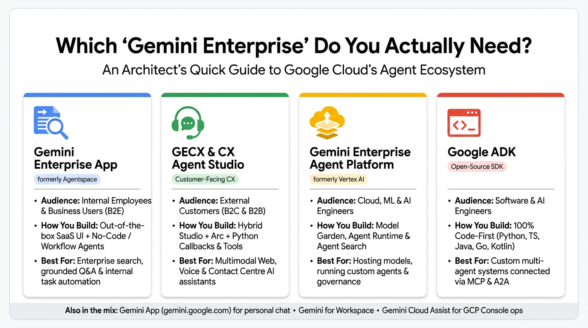

# Inside Gemini Enterprise for CX: Untangling Google Cloud's Agent Ecosystem and CX Agent Studio

Over the past few months, I've been spending a lot of time working hands-on with Gemini Enterprise for Customer Experience (GECX) and CX Agent Studio, designing and building customer-facing AI assistants.

Before we get into the architecture, though, we need to clear up Google's product naming.

I spend a disproportionate amount of time in customer workshops and architecture reviews simply clarifying which Google Cloud service actually does what. Now that Google has badged almost everything as either *"Gemini"* or *"Gemini Enterprise"*, it has become genuinely confusing for engineering leaders and architects to tell where one platform ends and the next begins.

In this post, I want to set the scene properly:

1. Untangle the broader Gemini Enterprise and Google Agent ecosystem so you know which tool does what.
2. Walk through the core architecture and out-of-the-box capabilities of CX Agent Studio.
3. Give an honest architect's view on the ADK abstraction, Arc, and where low-code stops and real engineering begins.

---

## Untangling the "Gemini" Maze: Where Does GECX Fit?

When a client says, *"We want to build an agent in Gemini Enterprise,"* my first question is always: who is the end user, and who is building it?

Despite sharing the *Gemini Enterprise* name, Google's offerings split across three very distinct layers: Employee-Facing (B2E), Customer-Facing (B2C/B2B CX), and the Underlying AI & Agent Engineering Platform.

, Customer-Facing Gemini Enterprise for CX (GECX) and CX Agent Studio, and the underlying Gemini Enterprise Agent Platform (formerly Vertex AI) with Google ADK, Agent Runtime, Model Garden, and Agent Search.")
***Figure 1:** High-level view of how Gemini Enterprise App (B2E), Gemini Enterprise for CX / CX Agent Studio (B2C/B2B), and Gemini Enterprise Agent Platform (formerly Vertex AI) connect across Google Cloud.*

Here is how I break these down when aligning with engineering and business teams:

### 1. Gemini Enterprise App (Employee-Facing / B2E)

If you read my earlier Cloud Babble post on Google Cloud Agentspace, this is what Agentspace evolved into.

* **Gemini Enterprise (and the Gemini Enterprise app):** The out-of-the-box, employee-facing multimodal search and assistant application. It connects to internal enterprise systems (Google Workspace, SharePoint, Jira, Confluence, ServiceNow, Salesforce etc.) to query across internal silos, strictly enforcing the logged-in employee's source-system permissions.
* **Internal Hub & No-Code Automation:** It also acts as the internal hub where employees can use pre-built Google agents (such as Deep Research), work with NotebookLM Enterprise for grounded document synthesis and research notebooks, build their own no-code and workflow agents to automate day-to-day business tasks without writing code, or interact with custom internal agents published by the engineering team.

### 2. Gemini Enterprise for Customer Experience (GECX / GCX) and CX Agent Studio

While the Gemini Enterprise app looks *inward* at your employees, Gemini Enterprise for Customer Experience (commonly shortened to GECX or GCX) looks *outward* at your customers. Think of GECX as the overall customer experience suite, and CX Agent Studio as the specific platform inside it where you build, test, and deploy autonomous AI agents.

* **Naming lineage:** Its history shows how quickly this space has shifted. Contact Center AI (CCAI) evolved into Customer Engagement Suite (CES) (which is why you still see `ces` in the APIs and service agents), and now sits under Gemini Enterprise for Customer Experience (GECX / GCX).
* **Moving beyond Dialogflow CX:** Historically, customer-facing bots on Google Cloud lived in Dialogflow CX (great for deterministic state machines, painful for open-ended reasoning).
* **CX Agent Studio:** The next-generation agentic platform at the core of GECX / GCX. It is purpose-built for external websites, mobile apps, voice/telephony IVRs, and contact centres. In those environments you have no internal employee directory, and you need strict brand guardrails, PII redaction, high concurrency, low-latency voice, and deterministic control over customer interactions.
* **Companion GECX tools:** Alongside CX Agent Studio, the broader GECX suite includes Commerce Agents / AI Commerce Search, Customer Experience Insights (CX Insights) for analysing conversation trends and automated QA scoring, Agent Assist as a real-time copilot for human contact centre agents, and Dialogflow CX for legacy or strictly deterministic flows.

### 3. Gemini Enterprise Agent Platform (formerly Vertex AI) & Google ADK

This is the one that trips people up most often because of the name overlap with the Gemini Enterprise app. Gemini Enterprise Agent Platform is completely separate from the employee-facing Gemini Enterprise app. It is the rebranded Vertex AI platform.

It is the core Google Cloud AI/ML platform hosting your underlying foundation and agent infrastructure:

* **Model Garden:** Access to Google's first-party models (Gemini, Gemma, Veo), partner models (such as Anthropic's Claude), and open-weights models.
* **Agent Runtime *(formerly Vertex AI Agent Engine)*:** The fully managed, serverless execution runtime for production agents, complete with Session Service for active conversation state, Memory Bank for persistent long-term context, long-running operations, and custom container support.
* **Platform Governance:** Shared enterprise controls including Agent Identity, Agent Registry, and Agent Gateway, alongside observability and evaluation tooling.
* **Google ADK (Agent Development Kit):** Google's open-source, code-first framework ([adk-docs](https://google.github.io/adk-docs/)) for engineers building custom multi-agent systems. ADK supports Python, TypeScript, Java, Go, and Kotlin, with open interoperability via [MCP (Model Context Protocol)](https://modelcontextprotocol.io) for connecting agents to tools and data sources, and [A2A (Agent2Agent)](https://a2a-protocol.org) for collaborating across independent agents.
* **How it connects to GECX:** This isn't an "either/or" choice. Under the hood, CX Agent Studio is built on top of Google ADK concepts. If your engineering team builds a specialised custom agent in ADK and deploys it to Agent Runtime, you can surface it to employees inside the Gemini Enterprise app, or wire it directly into CX Agent Studio as a remote sub-agent via A2A.

### 4. The "Other Geminis" (Public Gemini App, Workspace, Cloud Assist, Code Assist)

Just to round out the picture when someone says *"the Gemini assistant"* in a meeting, here are the other major Gemini-branded products that frequently get mixed into the same conversation:

* **The Gemini App (`gemini.google.com`):** The public consumer web and mobile assistant (and the standalone chat experience included with Google Workspace licences). It is great for general-purpose personal chat, drafting, and research, but it is not a connected enterprise-wide data hub like the Gemini Enterprise app, nor a customer-facing channel platform like GECX.
* **Gemini for Google Workspace:** Embedded directly inside Gmail, Docs, Sheets, and Meet.
* **Gemini Cloud Assist:** The operational assistant inside the Google Cloud Console for designing infrastructure, troubleshooting networking, and managing FinOps.
* **Gemini Code Assist:** Google's IDE coding assistant (worth noting that Google sunset individual/consumer tiers in June 2026 and has been transitioning developers toward Antigravity, which is another reminder of how quickly this portfolio shifts).

*(Google also embeds role-specific assistants across its wider portfolio, such as Gemini in BigQuery, Looker, Databases, and Security Operations, but the four above are the ones that cause the most confusion when scoping agentic architectures.)*

### Architect's Quick Reference: Which One Does What?

***Figure 2:** Quick comparison of Google Cloud's four core Gemini Enterprise and agent development offerings by audience, build model, and use case.*

| Product / Service | Primary Audience | Build Experience | Core Use Case |
| :--- | :--- | :--- | :--- |
| **Gemini App (`gemini.google.com`)** | Consumers & Individual Users | Ready-to-use Web / Mobile Chat | General-purpose personal chat, writing, research, and standalone Workspace chat. |
| **Gemini Enterprise App** *(ex-Agentspace)* | Internal Employees & Business Users (B2E) | Out-of-the-box SaaS UI + No-Code Agent / Workflow Builder | Employee-facing enterprise search, no-code/workflow task automation for business users, and interacting with published internal agents. |
| **GECX / GCX & CX Agent Studio** | External Customers (B2C / B2B) | Hybrid Console + REST API + Python Callbacks/Tools | Customer-facing digital & voice assistants across Web, Mobile, WhatsApp, and Contact Centres (CCaaS). |
| **Gemini Enterprise Agent Platform** *(ex-Vertex AI)* | Cloud, ML & AI Engineers | Full AI/ML Platform (Model Garden, Agent Runtime, Registry) | Hosting models, running custom agents on Agent Runtime (Session Service & Memory Bank), and platform governance. |
| **Google ADK** | Software & AI Engineers | 100% Code-First (Python, TypeScript, Java, Go, Kotlin) | Writing custom multi-agent logic that runs on Agent Runtime (or elsewhere) and plugs into GECX / Gemini Enterprise via A2A & MCP. |
| **Dialogflow CX** | External Customers | Visual State-Machine Flow Builder | Strictly deterministic, compliance-heavy IVR and transactional flows (callable as a sub-agent from CX Agent Studio). |
| **Gemini Cloud Assist** | Cloud Architects, SREs & Ops | Embedded in GCP Console | Designing GCP architectures, troubleshooting cloud resources, and optimising FinOps. |

---

## Why We Needed CX Agent Studio

Anyone who has built enterprise chatbots or voice assistants over the last few years knows the classic trade-off.

With traditional intent-based platforms, you spent months mapping rigid intent trees, training utterance variations, and writing brittle webhook logic, only for the bot to fall over the moment a customer phrased a question slightly differently or asked two things at once.

Wiring a raw LLM directly to your backend APIs on a public website creates the opposite problem. How do you stop the model from hallucinating policies or product specs? How do you enforce deterministic business rules when an LLM is driving the conversation? And how do you bolt on multi-turn evaluations, PII redaction, guardrails, and omnichannel voice/web delivery without stitching five separate services together yourself?

CX Agent Studio sits right in the middle of that trade-off: Gemini's reasoning and natural conversation, wrapped in a managed, multi-agent control plane with code-level escape hatches when you need deterministic behaviour.

---

## The Core Architecture of CX Agent Studio

When you open CX Agent Studio (or inspect the underlying `ces.v1` API resource model), everything is organised around a clean hierarchy.

 connecting into a GECX App container with global settings, guardrails, Cloud DLP redaction, VPC-SC egress allowlists, a Root Agent delegating via handoff rules to specialised Child Agents (including Remote Dialogflow CX and A2A), OpenAPI and Python tools, Agent Search data stores, Python lifecycle callbacks, and built-in evaluations.")
***Figure 3:** Core architecture of CX Agent Studio, illustrating channel profiles, the GECX App container, multi-agent handoff rules, tools, Python callbacks, and built-in evaluations.*

At an architectural level, the platform breaks down into seven core building blocks:

1. **The App Container:** The top-level boundary holding global instructions (consistent brand tone), default model settings, session variables, logging/BigQuery exports, and app-level VPC-SC egress allowlists (for OpenAPI tool origins when the project sits inside a VPC Service Controls perimeter).
2. **Root & Child Agents:** Instead of cramming everything into one monolithic prompt, a Root Agent handles entry and triage while delegating to specialised Child Agents. Those child agents can be native LLM agents, legacy Dialogflow CX flows (for strict compliance or PCI flows), or external agents reached via A2A. Hand-offs can be left to the LLM planner or enforced via deterministic handoff rules.
3. **Tools, Toolsets & Data Stores:** Agents connect to backend systems via OpenAPI specs, custom Python function tools, or grouped toolsets (supporting parallel or sequential execution), alongside native Agent Search *(formerly Vertex AI Search)* data stores for grounding against manuals, policies, and product catalogues.
4. **Out-of-the-Box Multimodality:** Through Channel Profiles and the configurable Web Widget, the same agent app handles text, voice, images, and live video. Voice support spans 40+ languages (with barge-in awareness and noise suppression), alongside direct audio-to-audio processing that bypasses legacy `STT → LLM → TTS` latency across core languages. Native visual reasoning lets customers upload images or share live video without bolting on a separate computer vision pipeline.
5. **Python Lifecycle Callbacks:** Deterministic Python hooks before and after agent execution, model calls, and tool invocations. When you need to sanitise inputs, trim bloated API payloads before they hit the context window, or override a response under a specific condition, callbacks give you code-level control without fighting the prompt.
6. **Guardrails, Redaction & Enterprise Security:** App- and agent-level guardrails for safety and topic boundaries, native Cloud DLP redaction before logs or recordings hit BigQuery/GCS, VPC Service Controls (VPC-SC) perimeter support at the project level, and private backend connectivity via Service Directory, Private Network Access, Secret Manager, and OAuth 2.0.
7. **Built-in Evaluations:** Native support for both Golden Evaluations (turn-by-turn semantic similarity and exact tool-call/parameter checks) and Scenario Evaluations (multi-turn simulated user personas) with hallucination detection and threshold gates.

---

## The ADK Abstraction, Arc, and the PoC-to-Production Reality Check

One of the strongest selling points of CX Agent Studio is how effectively it abstracts the complexity of Google ADK.

Features like Arc (the built-in AI Co-Builder) take that abstraction even further. You can feed Arc a natural language prompt alongside a PRD, an OpenAPI spec, or sample call transcripts, and watch it scaffold a multi-agent structure, instructions, and starter tools in minutes. For rapid prototyping, workshops, and getting a Proof of Concept in front of stakeholders, that genuinely saves a lot of time.

Here is my honest take as an architect, though: do not mistake low-code scaffolding for production readiness.

I question how far a non-technical user can realistically push CX Agent Studio beyond a PoC. Getting a demo to answer ten happy-path questions in the console is easy. Taking an external, customer-facing AI assistant into production is a completely different discipline.

The moment you move past the prototype stage, you run straight into real software and cloud engineering problems:

* **Advanced Tooling & Callbacks:** Writing clean Python function tools and lifecycle callbacks to handle messy enterprise APIs, edge-case errors, and session state reliably.
* **Performance & Latency Optimisation:** Tuning model selection, thinking levels, prompt structure, and parallel vs. sequential tool execution so customers aren't staring at a loading spinner.
* **Systematic Evaluation:** Designing meaningful Golden and Scenario test suites that catch regressions and hallucinations before a prompt tweak breaks production.
* **Enterprise Deployment & Operations:** Managing app versioning, environment promotion (dev/test/prod), CI/CD pipelines, private networking, IAM boundaries, and Cloud DLP redaction.

CX Agent Studio lowers the barrier to *starting*, and it removes a lot of the repetitive backend plumbing. That is why I like it. But achieving reliable, production-grade complexity still demands strong architectural guidance and hands-on engineering expertise.

---

## Wrapping Up

If you have been trying to make sense of Google Cloud's rapidly evolving "Gemini Enterprise" portfolio, the clearest way to frame it is by audience and layer: Gemini Enterprise (and the Gemini Enterprise app) for internal employees, GECX / CX Agent Studio for external customer journeys, and Gemini Enterprise Agent Platform (Vertex AI) + ADK as the engineering foundation underneath.

For customer-facing assistants, CX Agent Studio sits in a practical middle ground, combining out-of-the-box multimodality and rapid scaffolding with the guardrails, Python hooks, and evaluation tooling that real production deployments require.

If you are evaluating GECX or untangling how these pieces fit into your own Google Cloud architecture, I'd be interested to hear what challenges you're running into.

---

Thanks for reading! Please feel free to share, [subscribe](https://www.cloudbabble.co.uk/subscribe) for updates, or follow me on [LinkedIn](https://linkedin.com/in/jamiethompson85).
